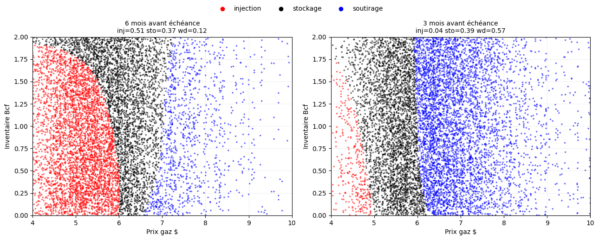
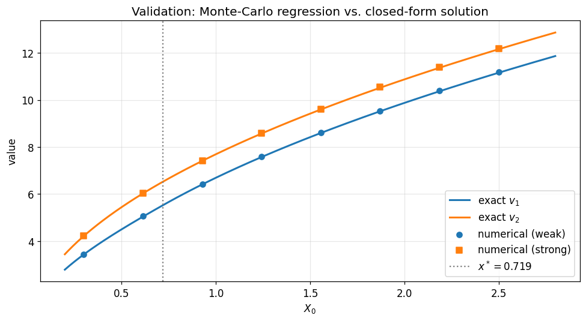
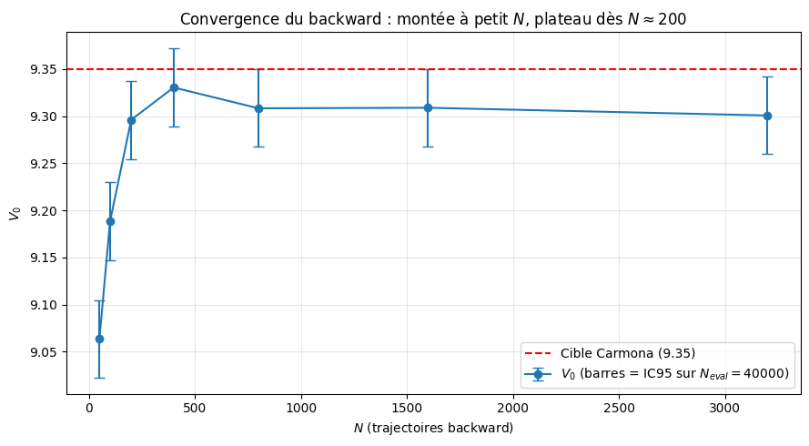
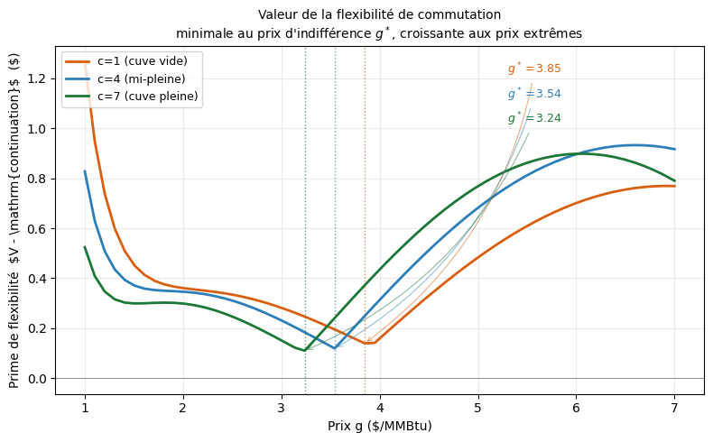
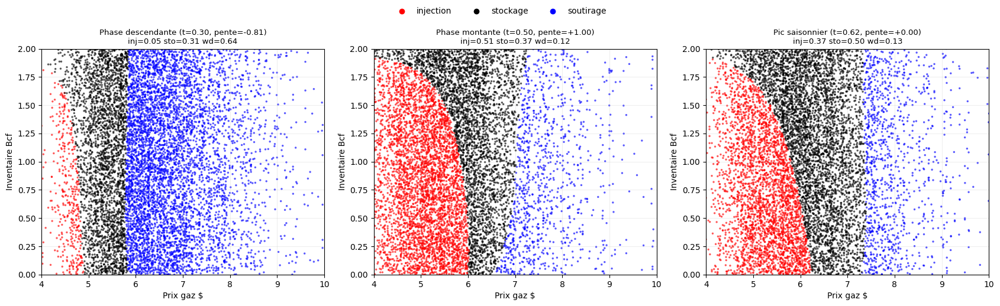
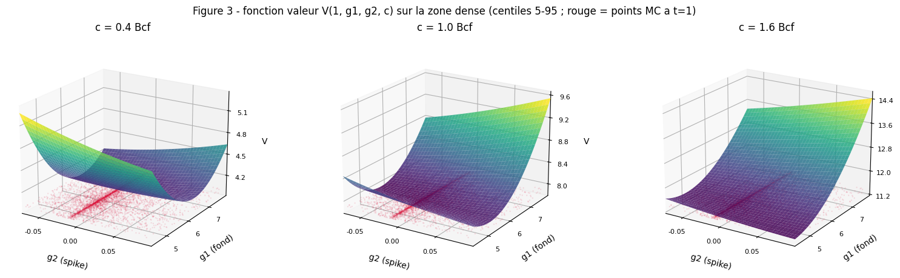
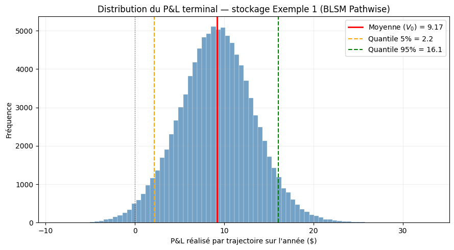

# Gas storage valuation by optimal switching — decoupled Bivariate LSMC

Numerical valuation of a natural gas storage facility as a three-regime **optimal switching** problem
(inject / store / withdraw), solved by Monte Carlo regression (**Bivariate Least-Squares Monte Carlo**, BLSM)
on the state (gas price, inventory).

> Master's thesis, **DU Financial Engineering 2025–2026** (Sorbonne Université – École Polytechnique, El Karoui programme),
> supervised by **Idris Kharroubi**. Full report (French): [`report/memoire_switching_optimal_FR.pdf`](report/memoire_switching_optimal_FR.pdf)

**Key idea — no look-ahead by construction.** The *backward* pass only regresses the pure continuation value
E[V(t+Δt) | F(t)]. A separate *forward* pass re-simulates independent paths and takes each decision from those
coefficients **at the current price only**. Controls are therefore adapted to the filtration, and the forward
(pathwise) estimator is a clean lower bound of the price.



*Optimal decision in the (price, inventory) plane, 6 and 3 months before maturity: inject at low prices (red),
store (black), withdraw at high prices (blue).*

---

## Results

### 1. Validation against a closed-form solution (no inventory)

Before adding inventory, the switching scheme is checked on the two-regime problem of **Ly Vath & Pham (2007)**,
which has an explicit solution (regime-dependent GBM, payoff x^γ).

| X₀ | 0.30 | 0.93 | 1.56 | 2.19 | 2.50 |
|---|---|---|---|---|---|
| Relative error, weak regime | 0.43% | 0.25% | 0.24% | 0.24% | 0.24% |
| Relative error, strong regime | 0.20% | 0.20% | 0.20% | 0.20% | 0.20% |

Error below **0.5%** across the price range. Convergence in N follows the Monte Carlo O(N^-1/2) rate down to a
discretisation floor, and the finite-horizon truncation becomes negligible for T ≳ 5/r.



### 2. Reproduction of Carmona & Ludkovski (2010) — Model 1, log-OU price

Three estimators share the same backward pass, compared on the reference case (G₀ = 3, C₀ = 4, T = 1):

| Method | V₀ | IC95 | Gap vs reference BLSM (9.35) |
|---|---|---|---|
| Point estimator (TViR-type) | 9.219 | 0.057 | −1.4% |
| **BLSM-forward (pathwise)** | **9.287** | 0.056 | **−0.7%** |
| BLSM-quasi | 9.293 | 0.054 | −0.6% |

Reference values in the paper range from 9.32 (coarse finite differences) to 9.86 (MITvR): there is no single
"true" value, and all three estimators here sit below MITvR, as expected for a Longstaff–Schwartz lower bound.

Across injection / withdrawal rates (paper's Table 3):

| a_in | a_out | Target | BLSM-forward | Error |
|---|---|---|---|---|
| 0.06 | 0.25 | 9.35 | 9.29 ± 0.09 | 0.6% |
| 0.03 | 0.125 | 4.75 | 4.47 ± 0.06 | 5.9% |
| 0.12 | 0.25 | 12.33 | 12.60 ± 0.11 | 2.2% |

The low-rate case is the hardest: value builds up over long windows, giving the value function a strong
curvature in inventory that a moderate-degree basis only partly captures (the estimate rises monotonically
with the basis degree, a truncation bias — see the notebook annex).

**Engineering sensitivities** (paper's Table 4) reproduce the expected monotonicities: value increases with
capacity (and saturates), and decreases with switching cost and storage cost.



*Estimate vs number of backward paths: rises at small N, plateaus from N ≈ 200, below the Carmona target.*

### 3. Flexibility premium

The gap between the value function V = maxⱼ(cash-flowⱼ + continuationⱼ) and the continuation value measures
the value of being able to switch. It is minimal at a state-dependent **indifference price** g\*
(3.85 / 3.54 / 3.24 for an empty / half-full / full tank) and grows towards extreme prices.



### 4. Seasonal storage — Model 2

Mean-reverting price around a seasonal level θ(t) = θ₀ + A sin(ωt), inventory-dependent injection and
withdrawal rates, gas losses. The optimal policy follows the seasonal phase — inject on the rising phase,
withdraw on the falling phase, hold at the peak — obtained without any look-ahead.



### 5. Two-factor price with jumps — Model 3

Price G = G₁·exp(G₂): a mean-reverting background factor and a Poisson spike factor. Only the price dynamics
change; the switching engine is unchanged. Value increases with the jump intensity, since every spike is a
selling opportunity a one-factor model cannot capture:

| Jump intensity λ | 6 | 12 | 24 |
|---|---|---|---|
| V₀ (± IC95) | 9.06 ± 0.03 | 9.93 ± 0.04 | 11.68 ± 0.04 |



### 6. Risk profile of the optimal policy

Distribution of the realised P&L per path at the optimum (Model 1): mean 9.17 (= V₀), standard deviation 4.21,
5%–95% interval [2.2, 16.1], 1.6% of losing scenarios.



---

## Repository

| Path | Content |
|---|---|
| [`notebooks/01_validation_ly_vath_pham.ipynb`](notebooks/01_validation_ly_vath_pham.ipynb) | Switching scheme vs closed-form solution, convergence in N, Δt, T |
| [`notebooks/02_gas_storage_blsm.ipynb`](notebooks/02_gas_storage_blsm.ipynb) | Main notebook: decoupled BLSM engine, Models 1 and 2, Carmona–Ludkovski tables, figures, annex (estimator comparison, basis degree, convergence, P&L / VaR) |
| [`notebooks/03_multifactor_jumps.ipynb`](notebooks/03_multifactor_jumps.ipynb) | Model 3: two-factor price with jumps, value surface, jump-intensity sensitivity |
| [`report/memoire_switching_optimal_FR.pdf`](report/memoire_switching_optimal_FR.pdf) | Full thesis (French, 20 pages) |
| [`figures/`](figures) | Figures used in this README |

```bash
pip install -r requirements.txt
jupyter notebook notebooks/
```

Notebooks run top to bottom (Python, NumPy, Matplotlib). They are compute-heavy: notebook 01 (validation grid and
convergence study) and the annex of notebook 02 (multi-seed studies) can take tens of minutes on a laptop.

## Limitations and next steps

- **Basis truncation** in low-rate configurations: a richer basis or a non-polynomial approximator (Deep BSDE)
  would reduce the bias.
- **Greeks**: the max in the Bellman recursion makes finite differences unstable; Malliavin / pathwise methods
  are a natural extension.
- **Correlated multi-commodity dynamics** for spread trading, of which Model 3 is a first step.

## References

- R. Carmona, M. Ludkovski (2010). *Valuation of energy storage: an optimal switching approach.* Quantitative Finance, 10(4).
- B. Djehiche, S. Hamadène, A. Popier (2009). *A finite horizon optimal multiple switching problem.* SIAM J. Control Optim., 48(4).
- V. Ly Vath, H. Pham (2007). *Explicit solution to an optimal switching problem in the two-regime case.* SIAM J. Control Optim.
- F. Longstaff, E. Schwartz (2001). *Valuing American options by simulation: a simple least-squares approach.* Review of Financial Studies.
